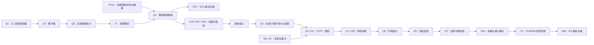

# AM 调幅发射与超外差接收系统

基于 **NI Multisim 14.3** 的模拟通信课程实验项目，包含调幅发射端、超外差接收端，以及将两端放在同一张图中的完整系统。

AM transmitter and superheterodyne receiver simulation for learning analog communication circuits. Native Multisim designs and Chinese explanations of every functional stage are included.

> **项目状态：教学仿真工程。** 系统设计采用“发射端输出 → 隔直与衰减 → 超外差接收”的信号路径。本仓库提供原始电路、逐级原理说明和参数清单，具体测试配置与验证进度见 [版本说明](docs/04-status-and-limitations.md)。

## 文件怎么用

- [AM收发系统.mp14](multisim/AM收发系统.mp14)：工程入口，统一管理下面三份电路。
- [01_调幅发射端.ms14](multisim/01_调幅发射端.ms14)：载波振荡、缓冲、高频放大、调幅与输出负载。
- [02_超外差接收端.ms14](multisim/02_超外差接收端.ms14)：保留 AM 测试源，可单独观察接收端各级响应。
- [03_完整收发系统.ms14](multisim/03_完整收发系统.ms14)：包含两端及耦合、衰减网络，用于研究完整收发链路。

`.mp14` 主要保存文件引用，所以体积只有几 KB 是正常的；元件、连线、模型和仪器状态保存在 `.ms14` 中。下载并解压整个仓库，即可保留完整工程结构。

## 快速开始

1. 点击 GitHub 的 **Code → Download ZIP**，完整解压到本地文件夹。
2. 使用 Multisim 14.3 打开 `multisim/AM收发系统.mp14`。
3. 在 **Design Toolbox → Project View → Schematic** 中双击需要的电路。
4. 如果工程入口未能定位到文件，直接打开对应 `.ms14`，或者在项目视图重新添加这三份文件。
5. 先停止仿真并保存副本，再进行调试。优先从单独的发射端或接收端开始。

本仓库只整理工程入口的路径引用，便于从其他目录打开；三份 `.ms14` 的字节与用户提交压缩包中的文件一致。校验值见 [SHA256SUMS.txt](metadata/SHA256SUMS.txt)。

## 整个系统在做什么

发射端把低频音频变化放到高频载波的**幅度**上；接收端先把载波搬移到固定中频，再从中频的包络中取回音频。

框图表示设计的信号处理路径。工程入口统一管理三份设计，完整系统文件将发射与接收电路放在同一张原理图中，便于逐级观察和联调。

## 发射端各部分的作用

### 1. 高频振荡器 Q1

`Q1` 和 LC 电容反馈网络自行建立高频振荡，为发射机提供载波。`L1`、可调电容 `C3` 以及反馈电容共同影响振荡频率，`R1/R3` 设置基极偏置，`R2` 提供集电极供电路径，`R4` 稳定工作点。

该级建立高频载波。启动时幅度逐渐增长，稳定后可观察载波周期、幅度和频率。

### 2. 缓冲级 Q2

`Q2` 采用射极跟随结构，主要隔离振荡器与后级负载，提供更强的驱动能力。它的电压增益通常接近 1，所以缓冲前后波形形状相似是正常现象。`R8` 用于调节送往高频放大级的驱动量。

### 3. 高频谐振放大 Q3

`Q3` 放大载波，`L2/C10` 构成集电极谐振负载，帮助选择需要的高频成分。`C9/C11` 用于级间耦合，`R10/R11` 提供偏置，`R9/C12` 属于发射极工作点及交流旁路网络。偏置和晶体管导通角决定该级的工作类别。

### 4. 耦合变压器 T1

`T1` 将射频驱动耦合到调幅级。当前为 `1:1` 模型。其变比、绕组参数及磁芯模型共同影响射频传输。

### 5. 调幅级 Q4 与 XFG1

载波进入 `Q4` 基极，`XFG1` 的低频信号及直流偏置加到其集电极供电侧，改变射频输出幅度。**本项目采用集电极侧调幅**。

`L3/C14` 为调幅级谐振网络，`R12` 为发射极电阻，`R15` 是 `50 Ω` 输出负载。输出应具有高频振荡和随音频变化的包络。基极射频驱动和集电极侧音频共同形成 AM 输出。

本版本使用函数发生器代表音频输入，便于设置固定音频频率并比较收发波形。

## 接收端各部分的作用

### 1. AM 测试源 V2

`V2` 直接生成已经调幅的射频信号，用于接收机单机测试。文件中保存的参数是：载波峰值幅度 `5 mV`、载波 `1.005 MHz`、音频 `1 kHz`、调制度 `0.3`。

单机接收文件通过 V2 提供输入，收发联调通过发射端耦合支路提供输入。输入源的选择方法见 [仿真指南](docs/03-simulation-guide.md)。

### 2. 高频小信号放大与选频 Q5

`Q5` 放大接收输入的微弱射频。`L4/C16` 在目标载波附近选频；`R16/R17` 设置偏置；`R18/C19` 稳定发射极工作点并提供交流旁路；`C15/C18` 为输入和输出耦合；`R19` 同时影响谐振回路负载与增益。

该级输出为经过选频、放大的高频 AM 信号，保留音频包络。

### 3. 本振 Q6 与缓冲 Q7

本振产生接收机内部使用的高频信号。`Q6`、`L5` 和电容反馈网络构成振荡器；`Q7` 为缓冲级；`C25` 采用较小容量耦合，降低后级对振荡器的影响；`R31` 调节送往混频器的本振驱动量。

发布快照中的 `L5=47 μH`，调谐电容 `C22=33 pF`。本振频率由整个振荡网络决定，调谐时同时观察实际频率、振荡幅度和稳定性。

### 4. 混频器 D1～D4、T2/T3

二极管环和变压器把射频与本振混合，产生和频、差频及其他分量，再由中频网络选择需要的差频。混频的目标是**搬移载波频率并保留音频包络**。

本项目采用高侧本振时：

`f_IF = f_LO − f_RF`

例如输入 `1.005 MHz`、目标中频 `455 kHz`，本振目标为约 `1.460 MHz`。若实际输入变成 `1.035 MHz`，对应目标本振为约 `1.490 MHz`。调试时按测得的输入载波设置对应本振频率。

### 5. 中频选频与放大

`R32/L6/C28` 属于混频后的中频选频网络，`R34` 调节送入中放的信号。`Q8` 放大固定中频，`L7/C31` 形成谐振负载，中心频率约为 `456 kHz`，与标称 `455 kHz` 的实验目标接近。

`R37/R38/C30` 的发射极网络兼顾稳定和交流增益；`C32` 将中频耦合到检波器，`R40` 提供输出端对地回路。中放输出应仍有 AM 包络，幅度应足以驱动后面的二极管检波。

### 6. 包络检波与低通滤波

`D5=1N5711` 对中频进行整流；`R41=47 kΩ` 和 `C34=470 pF` 构成基本检波储能、放电网络。电容在载波峰值附近充电，并在两次峰值之间放电，使输出跟随较慢的音频包络。

`R42=4.7 kΩ`、`C35=6.8 nF` 继续衰减残留中频纹波。它会对前级检波器形成负载，因此应在同一次仿真、同一参考地和相同显示条件下比较滤波前后。

二极管后直接测量时，通常能看到**正直流偏置、低频起伏和中频残留**。音频周期可通过包络峰值间隔测量，残留中频纹波则用更短的时间窗口观察。

### 7. 音量与 TDA2030 音频功放

`R43=100 kΩ` 是接收音量电位器；`C36=100 nF` 隔离检波输出直流；`R44=22 kΩ` 给同相输入提供偏置回路。

`U1=TDA2030` 将音频放大以驱动 `R48=8 Ω` 的模拟负载。`R46=22 kΩ` 与 `R45=680 Ω` 设置中频段音频闭环增益，约为 `1 + 22000/680 ≈ 33.4`；整条音频通路的增益还受到音量电位器和前级源阻抗影响。

`C37=22 μF` 位于反馈对地支路；`R47=1 Ω` 与 `C42=220 nF` 是输出稳定网络；`D6/D7` 为输出钳位保护；`C38/C40=100 nF`、`C39/C41=100 μF` 为电源去耦。

## 供电与信号参考

- 高频放大、本振和中放沿用图中的 `+12 V` 供电。
- TDA2030 使用 `+12 V / GND / −12 V` 双电源；两只标为 `12 V` 的电源要通过极性和中点接地形成正负供电。
- 两端有线连接时使用公共参考地。测量时明确标注信号节点和参考节点。
- 完整系统中的 `C20/R21/R22` 提供隔直与约 `1/100` 的衰减：`R21=10 kΩ` 串联、`R22=100 Ω` 对地。此网络用于有线仿真实验中的级间连接。

## 观察与调试

- **看完整包络或直流偏置**：使用 DC 耦合。
- **看交流音频**：使用 AC 耦合。
- **“0”耦合按钮**：显示该通道的零参考线。
- **看 1 kHz 音频/包络**：可从 `200 μs/Div` 开始。
- **看载波或中频单个周期**：需要微秒或更短的时间窗口；毫秒范围适合观察包络，微秒范围适合观察高频周期。
- 比较前后两点，应使用同一台示波器 A/B 通道、相同时间段和明确的公共参考地。
- 仿真步长要能解析最高频率。短时测试可从 `20 ns` 最大步长、`5 ms` 结束时间起步；打开原生文件后，在仿真设置中核对这些参数，并根据后续周期的重复性判断稳态。
- 历史记录、仪器数量与点数会增加内存。先保存，再做有限时长测试；需要回看时，提前启用历史数据保留。

更详细的操作见 [仿真与验证指南](docs/03-simulation-guide.md)。

## 进一步阅读

- [发射端逐级说明](docs/01-transmitter.md)
- [接收端逐级说明](docs/02-receiver.md)
- [仿真、仪器与真实收发验证](docs/03-simulation-guide.md)
- [版本与测试配置](docs/04-status-and-limitations.md)
- [按文件提取的参数与测量点](docs/05-snapshot-reference.md)
- [第三方材料说明](THIRD_PARTY_NOTICES.md)

## 参考资料

- [NI：AM Voltage Source](https://www.ni.com/docs/en-US/bundle/multisim/page/topics/am-voltage-source.html)
- [NI：Multisim Getting Started Guide](https://download.ni.com/support/manuals/374482h.pdf)
- [Analog Devices：AM 与包络检波](https://wiki.analog.com/university/courses/alm1k/circuits1/alm-cir-envelope-detector)
- [Analog Devices：混频基础实验](https://wiki.analog.com/university/courses/electronics/electronics-lab-active-mixer)
- [ST：TDA2030 数据手册](https://www.st.com/resource/en/datasheet/tda2030.pdf)

## 许可

原创说明与项目整理采用 [MIT License](LICENSE)。第三方模型及资料沿用各自许可，见 [第三方说明](THIRD_PARTY_NOTICES.md)。
